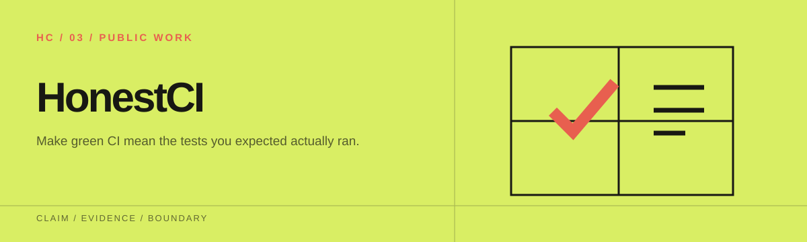
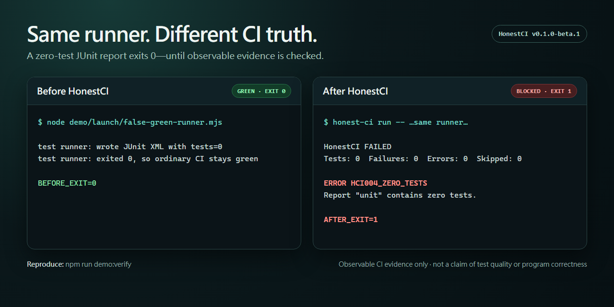

<p align="center">
  
</p>

# HonestCI

[English](README.md) · [繁體中文](README.zh-TW.md) · [简体中文](README.zh-CN.md) · [日本語](README.ja.md)

CI の緑を「期待したテストが実際に実行された」という意味にします。

HonestCI はテストコマンドをラップし、証拠が確認できない限り実行を成功扱いにしません。今回の実行で新しい JUnit レポートが生成されたかを確認し、テスト数をデフォルトブランチの信頼できるベースラインと比較します。また、GitHub Actions で失敗を隠しやすい書き方を警告します。



[before/after demo](launch/DEMO.md) では、同じ zero-test runner を 2 回実行します。単独で実行すると exit 0 で終わります。HonestCI でラップすると JUnit 証拠が検査され、`HCI004_ZERO_TESTS` でブロックされます。

```text
導入前：npm test || true                 → 成功
導入後：JUnit XML が未更新または存在しない → HCI003 / HCI001 → ブロック
```

現在のリリースは `v1.0.6` です。1.x の間、公開インターフェースへの変更は追加のみで、既存の使い方は壊れません。再現性が必要な場合は `v1.0.6` に固定してください。移動する `v1` タグは、最新の互換 1.x リリースに追従します。

## 5 分 Quick Start

まずテストランナーから JUnit XML を出力するよう設定し、`honest-ci.yml` を追加します。

```yaml
version: 1
reports:
  - name: unit
    paths: [reports/junit*.xml]
    format: junit
    min_tests: 1
    max_drop_percent: 10
    max_skipped_percent: null
baseline:
  file: .honest-ci/baseline.json
  source: default-branch
workflows:
  paths: [.github/workflows/*.yml]
```

checkout と依存関係のインストールの後に Action を追加し、例のコマンドを自分の JUnit テストコマンドに置き換えます。完全な commit で固定しておけば、タグが移動しても workflow の内容は変わりません。

```yaml
- uses: f0909172434/honest-ci@v1.0.6
  with:
    command: npm test -- --reporter=junit --outputFile=reports/junit.xml
    config: honest-ci.yml
    github-token: ${{ github.token }}
    evidence-output: .honest-ci/evidence.json
```

npm registry からバージョンを固定して CLI をインストールします。

```console
npm install --save-dev honest-ci@1.0.6
```

デフォルトブランチで一度成功したら、ベースラインを生成し、内容を確認してからコミットします。

```console
npx honest-ci baseline write --config honest-ci.yml -- npm test
git add .honest-ci/baseline.json
git commit -m "Add HonestCI baseline"
```

Action に必要な権限は `contents: read` だけです。annotations と Job Summary を出力しますが、PR へのコメントは自動では投稿しません。

## 検出する問題

次の問題は観測できる確かな証拠があるため、実行を失敗させます。

- ラップしたコマンドが 0 以外を返した。
- 必須レポートが存在しない、壊れている、安全でないパスにある、または今回の実行で更新されていない。
- テスト数が 0、設定した最小値未満、または failures や errors がある。
- テスト数が信頼できるベースラインから設定値を超えて減った。
- 明示的に設定した skipped 率の上限を超えた。

静的な記述だけでは確定できないものは警告にとどめます。

- `continue-on-error: true`
- `|| true` または強制的な `exit 0`
- Jest や Vitest の `--passWithNoTests`
- テストらしい job や step を省略し得る動的条件

自動処理では [finding codes](docs/FINDINGS.md) を基準にしてください。これらのコードは安定した機械向けインターフェースです。

## CLI

Node.js 20 以降が必要です。

```console
npm install --save-dev honest-ci@1.0.6
npx honest-ci lint
npx honest-ci run --config honest-ci.yml -- npm test
npx honest-ci check --config honest-ci.yml
npx honest-ci baseline write --config honest-ci.yml -- npm test
```

人が読む出力には `--format pretty`、プログラムで処理する出力には `--format json` を使います。Exit code は、成功が 0、確定した問題が 1、設定または入力のエラーが 2 です。

`baseline write` にはテストコマンドを渡すことを推奨します。そうすると、コマンドが成功し、設定したレポートが実際に更新された場合にだけ HonestCI がベースラインを書き込みます。互換性のためコマンドは省略できますが、その場合は既存のレポートに `HCI107_FRESHNESS_UNVERIFIED` が付きます。

## 再現可能な偽の成功 demo

ソースのルートで実行します。

```console
npm ci
npm run build
node dist/cli/index.js lint --config demo/false-green/honest-ci.yml
node dist/cli/index.js check --config demo/false-green/honest-ci.yml
node dist/cli/index.js check --config demo/healthy/honest-ci.yml
```

最初のコマンドは、よくある 4 種類の workflow リスクを警告します。2 番目のコマンドは、JUnit レポートにテスト数 0 が明記されているため失敗します。健全な fixture では hard finding は出ません。詳しくは [demo](demo/README.md) を参照してください。

`npm run demo:scenarios` を実行すると、互いに分離した 7 つのシナリオをまとめて再現できます。レポート欠落、テスト数 0、古いレポート、テスト数の減少、失敗テスト、レポートのパス探索が含まれます。各シナリオの期待結果は[シナリオ表](demo/scenarios/README.md)にあります。

## 信頼できるベースライン

PR で実行するとき、Action は GitHub API を使って base commit の `.honest-ci/baseline.json` を読みます。そのため、PR がワークスペース内のコピーを書き換えて比較基準を下げることはできません。fork に読み取り権限がない場合でも、HonestCI は固定の最小テスト数を検査し、`HCI106_BASELINE_UNAVAILABLE` を表示します。

## 対象範囲と制限

HonestCI v1 は GitHub Actions と JUnit XML に対応し、Ubuntu、Windows、macOS で動作します。workflow YAML の実行、SaaS としての提供、カバレッジ分析、GitLab、CircleCI、TRX への対応、AI API の呼び出し、PR への自動コメントは行いません。

HonestCI が確認するのは、CI の実行が残した証拠です。検査に通っても、テストが十分であること、アサーションに意味があること、必要なテストがすべて存在すること、プログラムが正しいことは示されません。

関連ドキュメント：

- 設定：[docs/CONFIGURATION.md](docs/CONFIGURATION.md)
- [導入ガイド](docs/ADOPTION_GUIDE.md)
- [技術概要](docs/TECHNICAL_OVERVIEW.md)
- [テストランナー例](docs/RUNNER_RECIPES.md)
- [互換性と制限](docs/COMPATIBILITY.md)
- [リリース方針](docs/RELEASE_POLICY.md)
- セキュリティ：[SECURITY.md](SECURITY.md)
- [脅威モデル](docs/THREAT_MODEL.md)
- コントリビューション：[CONTRIBUTING.md](CONTRIBUTING.md)
- [メンテナンス](docs/MAINTENANCE.md)
- [公開導入証拠](ADOPTION.md)

## Evidence Bundle v1

`run` と `check` は `--evidence-output .honest-ci/evidence.json` で RigorGraph Evidence Bundle v1 を生成できます。Action にも同名の input があり、`evidence-path` を output として返します。

バンドルに含まれるのは、結果の要約、設定／レポート／ベースライン／workflow のハッシュ、許可リストに限定した GitHub provenance だけです。JUnit 本文、テスト名、log、任意の環境変数、秘密情報は含みません。ハッシュは HonestCI が観測したバイト列を記録するもので、runner の真正性、テストの品質、プログラムの正しさを証明するものではありません。形式の詳細は [Evidence Bundle v1](docs/EVIDENCE_BUNDLES.md) と[リリース方針](docs/RELEASE_POLICY.md)を参照してください。

本プロジェクトは MIT License で提供されます。
