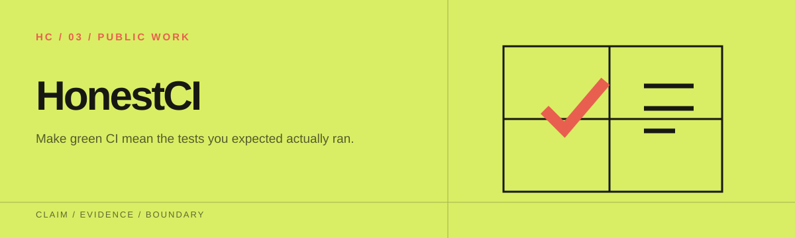
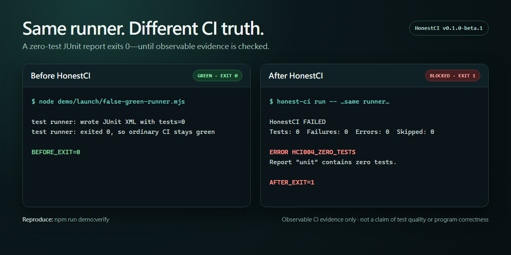

<p align="center">
  
</p>

# HonestCI

[English](README.md) · [繁體中文](README.zh-TW.md) · [简体中文](README.zh-CN.md) · [日本語](README.ja.md)

[](https://github.com/Chih-Kai-Wang/honest-ci/actions/workflows/ci.yml)
[](https://www.npmjs.com/package/honest-ci)
[](LICENSE)
[Security policy](SECURITY.md)

**Make green CI mean the tests you expected actually ran.**

HonestCI wraps your test command and refuses to call a run green unless it can
see the evidence. It checks that the run produced fresh JUnit XML, compares the
test count with a trusted baseline from the default branch, and warns about
GitHub Actions patterns that commonly hide failures.



The [reproducible demo](launch/DEMO.md) runs the same zero-test runner twice.
On its own the runner exits successfully. Wrapped by HonestCI, the same run is
blocked with `HCI004_ZERO_TESTS`.

For a broader local check, `npm run demo:scenarios` reproduces seven isolated
cases: a missing report, zero tests, a stale report, a reduced test count, a
failing test, and report discovery. The [scenario matrix](demo/scenarios/README.md)
lists each case and its expected result.

```text
Ordinary runner:  npm test || true                 -> green
With HonestCI:    missing, stale, or empty JUnit   -> finding -> blocked
```

HonestCI works alongside test reporters rather than replacing them. A reporter
makes results readable. HonestCI checks whether the expected evidence is fresh
and whether the observed test count still matches a trusted baseline. You can
use both in the same job.

The current release is `v1.0.6`. Changes within 1.x only add to the public
interfaces. Pin the protected semantic-version tag `v1.0.6` when you need
reproducible runs. The moving `v1` Action tag follows the latest compatible
1.x release.

## Capabilities at a glance

| Signal | What HonestCI evaluates | Result |
| --- | --- | --- |
| Test command | The wrapped command's exit status | Nonzero is a hard finding |
| JUnit reports | Presence, parseability, freshness, tests, failures, errors, and skipped tests | Definite problems fail the gate |
| Test-count baseline | Current count versus the same named report on the trusted baseline | A drop beyond your threshold fails |
| Workflow YAML | Common false-green patterns such as swallowed exits or permissive conditions | Heuristics are warnings, never proof |
| Evidence output | Result plus hashes and allowlisted GitHub provenance | Optional JSON bundle for retention or downstream use |

The Action also writes annotations and a Job Summary. Later workflow steps can
read its `tests`, `failures`, `errors`, `skipped`, `baseline-tests`,
`drop-percent`, `warnings`, and `evidence-path` outputs.

## Five-minute Quick Start

The example below uses Vitest. It wraps the test command, keeps the evidence
whether the run passes or fails, and uses the pull request's base commit as the
trusted baseline. For Jest, pytest, or Maven, keep the same structure and take
the test command from the [runner recipes](docs/RUNNER_RECIPES.md).

First add `honest-ci.yml`:

```yaml
version: 1
reports:
  - name: unit
    paths: [reports/junit*.xml]
    format: junit
    min_tests: 1
    max_drop_percent: 10
    max_skipped_percent: null
baseline:
  file: .honest-ci/baseline.json
  source: default-branch
workflows:
  paths:
    - .github/workflows/*.yml
    - .github/workflows/*.yaml
```

Then add `.github/workflows/tests.yml`:

```yaml
name: tests

on:
  pull_request:
  push:
    branches: [main]

permissions:
  contents: read

jobs:
  test:
    runs-on: ubuntu-latest
    steps:
      - uses: actions/checkout@3d3c42e5aac5ba805825da76410c181273ba90b1 # v7
      - uses: actions/setup-node@820762786026740c76f36085b0efc47a31fe5020 # v7
        with:
          node-version: 24
          cache: npm
      - run: npm ci
      - name: Run tests through HonestCI
        id: honest_ci
        uses: Chih-Kai-Wang/honest-ci@v1.0.6
        with:
          command: npm test -- --reporter=default --reporter=junit --outputFile.junit=reports/junit.xml
          config: honest-ci.yml
          github-token: ${{ github.token }}
          evidence-output: .honest-ci/evidence.json
      - name: Upload HonestCI evidence
        if: always()
        uses: actions/upload-artifact@043fb46d1a93c77aae656e7c1c64a875d1fc6a0a # v7
        with:
          name: honest-ci-evidence
          path: .honest-ci/evidence.json
```

A run passes when it produces a fresh report with at least one test, no
failures or errors, and no configured threshold violation. A missing or stale
report, zero tests, a failed command, or an excessive drop from the baseline
fails the Action and adds a stable `HCI...` annotation. The first run has no
baseline yet. It can still pass the fixed checks, and it reports
`HCI101_BASELINE_MISSING` as a warning.

The Action needs only `contents: read`. It does not comment on pull requests,
and it does not upload evidence by itself. Both remain explicit choices in
your workflow.

After a successful run on the default branch, create the baseline, review it,
and commit it:

```console
npm install --save-dev honest-ci@1.0.6
npx honest-ci baseline write --config honest-ci.yml -- npm test -- --reporter=junit --outputFile=reports/junit.xml
git add .honest-ci/baseline.json
git commit -m "Add HonestCI baseline"
```

Write the baseline with the same JUnit command you test with. On pull requests,
the Action reads the committed baseline from the base commit through the GitHub
API, so a pull request cannot lower its own baseline by editing the copy in its
workspace. The [adoption guide](docs/ADOPTION_GUIDE.md) covers advisory
rollout, multiple suites, choosing thresholds, and branch protection.

## What it catches

These definite, observable problems fail the run:

- The wrapped command returned a nonzero exit status.
- A required report is missing, malformed, unsafe, or unchanged.
- Zero tests ran, the configured minimum was not met, or failures or errors exist.
- The test count fell further below the committed baseline than the threshold allows.
- The skipped ratio exceeded an explicitly configured limit.

Heuristic matches stay warnings. They include `continue-on-error: true`,
`|| true`, a forced `exit 0`, Jest or Vitest `--passWithNoTests`, and dynamic
conditions that may skip a test-like job or step. The [finding codes](docs/FINDINGS.md)
page lists every stable code.

## Result and failure semantics

The GitHub Action fails its step when at least one definite error finding is
present. Warnings are reported but do not fail the step. Invalid configuration,
unsafe paths, or any other input that cannot be evaluated also fail the Action,
as an input error.

The CLI uses three exit statuses:

- `0` means the result was evaluated and has no definite error finding. Warnings may still be present.
- `1` means there is at least one definite finding, such as a failed command or an invalid report.
- `2` means the configuration or input could not be evaluated.

Automation should rely on the finding codes, which are stable. Human-readable
messages may improve during 1.x without changing what a code means.

## How the gate works

```text
honest-ci.yml + trusted baseline
              |
              v
snapshot reports -> run test command -> discover and parse fresh JUnit
                                              |
workflow lint warnings -----------------------+
                                              v
                              thresholds + finding codes
                                              |
                         +--------------------+-------------------+
                         v                    v                   v
                  exit / Action status   annotations/summary   evidence JSON
```

The CLI `run` command passes the test executable and its arguments directly,
without a shell. The Action's `command` input is a shell command, because
workflow authors normally write one command string. Never build that input from
values a pull request can control. All paths are confined to the workspace,
report globs do not follow symlinks, and JUnit files containing DTD or entity
declarations are rejected. The [technical overview](docs/TECHNICAL_OVERVIEW.md)
describes the execution paths, parser behavior, baseline trust boundary, output
schema, and security model in detail.

## When to use HonestCI

HonestCI fits a GitHub Actions job that already produces JUnit XML, where a
green run should be backed by evidence that the tests actually executed. It is
most useful when the number of tests should not quietly drop on a pull request.

It is not the right tool for coverage analysis, flaky-test analytics, hosted
dashboards, GitLab or CircleCI workflows, or proving that assertions are
meaningful. These are explicit non-goals for 1.x.

HonestCI does not make `honest-ci.yml` or your workflow files immutable. A pull
request can propose weaker thresholds or a different command. When these files
are part of a required gate, protect them with normal review, CODEOWNERS, and
branch rules.

## CLI

HonestCI requires Node.js 20 or newer.

```console
npm install --save-dev honest-ci@1.0.6
npx honest-ci lint --config honest-ci.yml
npx honest-ci run --config honest-ci.yml --evidence-output .honest-ci/evidence.json -- npm test -- --reporter=default --reporter=junit --outputFile.junit=reports/junit.xml
npx honest-ci check --config honest-ci.yml
npx honest-ci baseline write --config honest-ci.yml -- npm test -- --reporter=default --reporter=junit --outputFile.junit=reports/junit.xml
```

Use `--format pretty` when a person reads the output and `--format json` for
automation. The exit status is 0 for a pass, 1 for definite findings, and 2 for
invalid input or configuration. We recommend passing a test command to
`baseline write`. HonestCI then writes the baseline only when the command
succeeds and the configured reports are fresh. The command is still optional
for compatibility, but reports that already exist are then marked
`HCI107_FRESHNESS_UNVERIFIED`.

## Evidence Bundle v1

`run` and `check` accept `--evidence-output <relative-path>`. The GitHub Action
accepts the same input and returns `evidence-path`. Uploading the bundle is
still an explicit step in your workflow:

```yaml
- name: Upload HonestCI evidence
  if: always()
  uses: actions/upload-artifact@043fb46d1a93c77aae656e7c1c64a875d1fc6a0a # v7
  with:
    name: honest-ci-evidence
    path: .honest-ci/evidence.json
```

The bundle contains the result, hashes of the configuration, report, baseline,
and workflow files, and an allowlisted set of GitHub provenance fields. It does
not contain raw JUnit, test names, logs, arbitrary environment variables, or
secrets. The hashes record the bytes HonestCI observed. They do not prove that
the runner is authentic, that the tests are good, or that the code is correct.
[Evidence Bundle v1](docs/EVIDENCE_BUNDLES.md) documents the format.

## Reproduce the checks locally

```console
npm ci
npm run demo:scenarios
```

Each of the seven temporary scenarios asserts the expected exit status and
finding code. The original before-and-after zero-test demo is still available
as `npm run demo:verify`. These demos show that the fixtures are detected. They
do not show that HonestCI finds every possible CI defect.

## Trusted baselines

On a pull request, the Action fetches `.honest-ci/baseline.json` from the base
commit through the GitHub API. A pull request therefore cannot lower its own
comparison target by editing the copy in its workspace. If a fork cannot fetch
the baseline, HonestCI still runs its fixed minimum checks and emits
`HCI106_BASELINE_UNAVAILABLE`.

## Scope and documentation

HonestCI v1 supports GitHub Actions and JUnit XML on Ubuntu, Windows, and
macOS. It does not execute workflow YAML, run as a hosted service, analyze
coverage, support GitLab, CircleCI, or TRX, call an AI API, or post pull
request comments.

HonestCI checks the evidence a CI run leaves behind. A pass does not mean the
tests are sufficient, that their assertions are meaningful, that every test you
need exists, or that the program is correct.

Further reading:

- [Configuration](docs/CONFIGURATION.md)
- [Adoption guide](docs/ADOPTION_GUIDE.md)
- [Technical overview](docs/TECHNICAL_OVERVIEW.md)
- [Runner recipes](docs/RUNNER_RECIPES.md)
- [Compatibility and limitations](docs/COMPATIBILITY.md)
- [Release policy](docs/RELEASE_POLICY.md)
- [Security](SECURITY.md)
- [Threat model](docs/THREAT_MODEL.md)
- [Contributing](CONTRIBUTING.md)
- [Maintenance](docs/MAINTENANCE.md)
- [Public adoption evidence](ADOPTION.md)

HonestCI is released under the MIT License.
