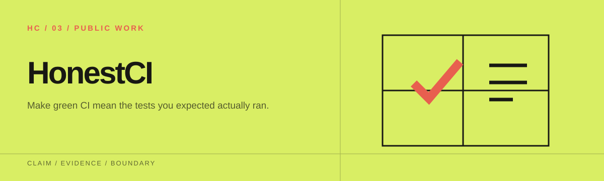
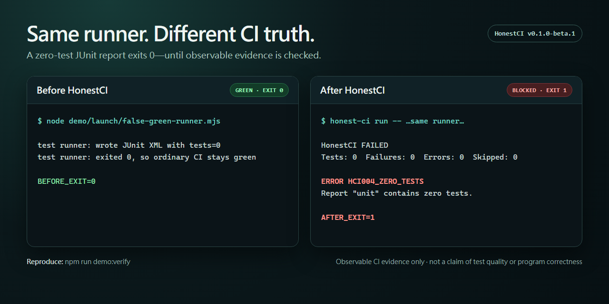

<p align="center">
  
</p>

# HonestCI

[English](README.md) · [繁體中文](README.zh-TW.md) · [简体中文](README.zh-CN.md) · [日本語](README.ja.md)

让 CI 的绿灯代表“预期要跑的测试确实跑过了”。

HonestCI 会包住你的测试命令，看不到证据就不给绿灯。它检查这次运行是否生成了新的 JUnit 报告，把测试数拿去和默认分支上的可信基准比较，并对 GitHub Actions 里常见的假绿灯写法发出警告。



[before/after demo](launch/DEMO.md) 用同一个零测试 runner 跑两次。单独运行时它返回 exit 0；交给 HonestCI 包住之后，HonestCI 检查 JUnit 证据，并以 `HCI004_ZERO_TESTS` 挡下这次运行。

```text
加入前：npm test || true                 → 绿灯
加入后：JUnit XML 未更新或不存在         → HCI003 / HCI001 → 阻止
```

目前版本是 `v1.0.6`。1.x 期间的公开接口只会添加，不会破坏已有用法。需要可复现的结果时请固定使用 `v1.0.6`。会移动的 `v1` 标签则会跟着最新的兼容 1.x 版本。

## 五分钟 Quick Start

先让测试工具输出 JUnit XML，再添加 `honest-ci.yml`：

```yaml
version: 1
reports:
  - name: unit
    paths: [reports/junit*.xml]
    format: junit
    min_tests: 1
    max_drop_percent: 10
    max_skipped_percent: null
baseline:
  file: .honest-ci/baseline.json
  source: default-branch
workflows:
  paths: [.github/workflows/*.yml]
```

在 checkout 与安装依赖的步骤之后加入 Action，并把示例命令换成你自己的 JUnit 测试命令。用完整的 commit 固定版本，标签移动时 workflow 的内容也不会跟着变。

```yaml
- uses: Chih-Kai-Wang/honest-ci@v1.0.6
  with:
    command: npm test -- --reporter=junit --outputFile=reports/junit.xml
    config: honest-ci.yml
    github-token: ${{ github.token }}
    evidence-output: .honest-ci/evidence.json
```

从 npm registry 安装固定版本的 CLI：

```console
npm install --save-dev honest-ci@1.0.6
```

默认分支成功跑过一次之后，生成基准、检查内容，再提交：

```console
npx honest-ci baseline write --config honest-ci.yml -- npm test
git add .honest-ci/baseline.json
git commit -m "Add HonestCI baseline"
```

Action 只需要 `contents: read` 权限。它会写入 annotations 与 Job Summary，但不会自动在 PR 上留言。

## 会拦下的问题

以下问题有明确的运行证据，会让这次运行失败：

- 测试命令返回非零。
- 必要的报告不存在、格式损坏、路径不安全，或这次运行没有更新它。
- 测试数为零、低于设置的最低值，或报告中有 failures 或 errors。
- 测试数比可信基准少，且降幅超过阈值。
- 用户设置了 skipped 比例上限，而结果超过上限。

以下写法只能从静态内容怀疑，所以只发出警告：

- `continue-on-error: true`
- `|| true` 或强制 `exit 0`
- Jest 或 Vitest 的 `--passWithNoTests`
- 可能让测试 job 或 step 被跳过的动态条件

自动化流程请以 [finding codes](docs/FINDINGS.md) 为准，这些代码是稳定的机器接口。

## CLI

需要 Node.js 20 或更高版本。

```console
npm install --save-dev honest-ci@1.0.6
npx honest-ci lint
npx honest-ci run --config honest-ci.yml -- npm test
npx honest-ci check --config honest-ci.yml
npx honest-ci baseline write --config honest-ci.yml -- npm test
```

给人看的输出用 `--format pretty`，给程序读的输出用 `--format json`。Exit code 为 0 表示通过，1 表示有确定的问题，2 表示配置或输入有误。

建议在 `baseline write` 后面接上测试命令。这样只有在命令成功、而且配置的报告确实更新时，HonestCI 才会写入基准。为了兼容旧用法，命令仍可省略，但这时已有的报告会被标上 `HCI107_FRESHNESS_UNVERIFIED`。

## 可复现的假绿灯 demo

在源码根目录运行：

```console
npm ci
npm run build
node dist/cli/index.js lint --config demo/false-green/honest-ci.yml
node dist/cli/index.js check --config demo/false-green/honest-ci.yml
node dist/cli/index.js check --config demo/healthy/honest-ci.yml
```

第一个命令会对四种常见的 workflow 风险发出警告。第二个命令会失败，因为 JUnit 报告明确记录了零个测试。健康的 fixture 则不会出现任何 hard finding。细节请看 [demo 说明](demo/README.md)。

运行 `npm run demo:scenarios` 可以一次复现七种彼此隔离的情境，包括缺少报告、零测试、旧报告、测试数下降、测试失败与报告路径探索。各情境的预期结果列在[情境矩阵](demo/scenarios/README.md)。

## 可信基准

在 PR 上运行时，Action 会通过 GitHub API 从 base commit 读取 `.honest-ci/baseline.json`。因此 PR 无法靠修改自己工作区里的副本来降低比较标准。如果 fork 没有权限读取基准，HonestCI 仍会运行固定的最低测试数检查，并显示 `HCI106_BASELINE_UNAVAILABLE`。

## 范围与限制

HonestCI v1 支持 GitHub Actions 与 JUnit XML，可在 Ubuntu、Windows 与 macOS 上运行。它不会运行 workflow YAML，不提供 SaaS 服务，不分析覆盖率，不支持 GitLab、CircleCI 或 TRX，不调用 AI API，也不会自动在 PR 上留言。

HonestCI 检查的是 CI 运行后留下的证据。通过检查不代表测试足够、断言有意义、该有的测试都存在，也不代表程序是正确的。

延伸文档：

- 配置：[docs/CONFIGURATION.md](docs/CONFIGURATION.md)
- [采用指南](docs/ADOPTION_GUIDE.md)
- [技术概览](docs/TECHNICAL_OVERVIEW.md)
- [测试工具示例](docs/RUNNER_RECIPES.md)
- [兼容性与限制](docs/COMPATIBILITY.md)
- [发布政策](docs/RELEASE_POLICY.md)
- 安全：[SECURITY.md](SECURITY.md)
- [威胁模型](docs/THREAT_MODEL.md)
- 贡献：[CONTRIBUTING.md](CONTRIBUTING.md)
- [维护流程](docs/MAINTENANCE.md)
- [公开采用证据](ADOPTION.md)

## Evidence Bundle v1

`run` 与 `check` 可以用 `--evidence-output .honest-ci/evidence.json` 产生 RigorGraph Evidence Bundle v1。Action 也有同名的 input，并返回 `evidence-path`。

证据包只包含结果摘要、设置档／报告／基准／workflow 的哈希值，以及白名单内的 GitHub provenance 字段。它不包含原始 JUnit、测试名称、log、任意环境变量或任何秘密。哈希值记录的是 HonestCI 观察到的字节，不能证明 runner 的身分、测试质量或程序的正确性。格式细节请看 [Evidence Bundle v1](docs/EVIDENCE_BUNDLES.md) 与[发布政策](docs/RELEASE_POLICY.md)。

本项目以 MIT License 授权。
