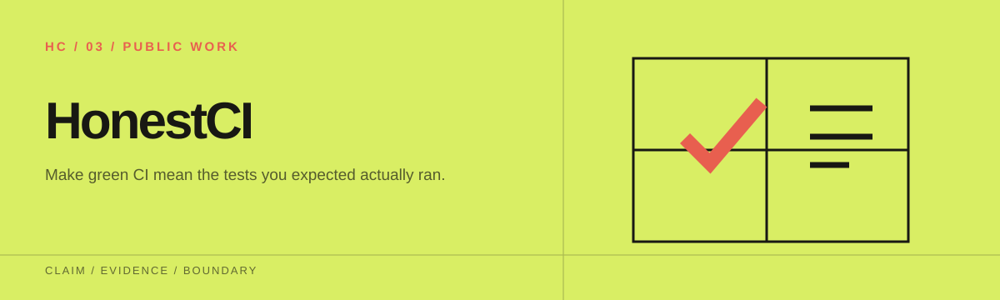
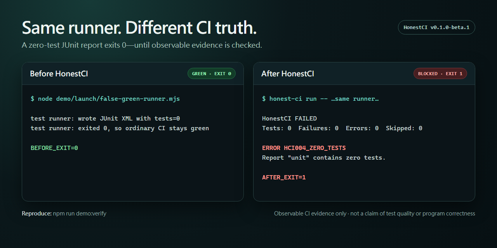

<p align="center">
  
</p>

# HonestCI

[English](README.md) · [繁體中文](README.zh-TW.md) · [简体中文](README.zh-CN.md) · [日本語](README.ja.md)

讓 CI 的綠燈代表「預期要跑的測試確實跑過了」。

HonestCI 會包住你的測試命令，看不到證據就不給綠燈。它檢查這次執行是否產生了新的 JUnit 報告，把測試數拿去和預設分支上的可信基準比較，並對 GitHub Actions 裡常見的假綠燈寫法發出警告。



[before/after demo](launch/DEMO.md) 用同一個零測試 runner 跑兩次。單獨執行時它回傳 exit 0；交給 HonestCI 包住之後，HonestCI 檢查 JUnit 證據，並以 `HCI004_ZERO_TESTS` 擋下這次執行。

```text
加入前：npm test || true                 → 綠燈
加入後：JUnit XML 未更新或不存在         → HCI003 / HCI001 → 阻擋
```

目前版本是 `v1.0.6`。1.x 期間的公開介面只會新增，不會破壞既有用法。需要可重現的結果時請固定使用 `v1.0.6`。會移動的 `v1` 標籤則會跟著最新的相容 1.x 版本。

## 五分鐘 Quick Start

先讓測試工具輸出 JUnit XML，再新增 `honest-ci.yml`：

```yaml
version: 1
reports:
  - name: unit
    paths: [reports/junit*.xml]
    format: junit
    min_tests: 1
    max_drop_percent: 10
    max_skipped_percent: null
baseline:
  file: .honest-ci/baseline.json
  source: default-branch
workflows:
  paths: [.github/workflows/*.yml]
```

在 checkout 與安裝依賴的步驟之後加入 Action，並把範例命令換成你自己的 JUnit 測試命令。用完整的 commit 固定版本，標籤移動時 workflow 的內容也不會跟著變。

```yaml
- uses: f0909172434/honest-ci@v1.0.6
  with:
    command: npm test -- --reporter=junit --outputFile=reports/junit.xml
    config: honest-ci.yml
    github-token: ${{ github.token }}
    evidence-output: .honest-ci/evidence.json
```

從 npm registry 安裝固定版本的 CLI：

```console
npm install --save-dev honest-ci@1.0.6
```

預設分支成功跑過一次之後，產生基準、檢查內容，再提交：

```console
npx honest-ci baseline write --config honest-ci.yml -- npm test
git add .honest-ci/baseline.json
git commit -m "Add HonestCI baseline"
```

Action 只需要 `contents: read` 權限。它會寫入 annotations 與 Job Summary，但不會自動在 PR 上留言。

## 會攔下的問題

以下問題有明確的執行證據，會讓這次執行失敗：

- 測試命令回傳非零。
- 必要的報告不存在、格式損壞、路徑不安全，或這次執行沒有更新它。
- 測試數為零、低於設定的最低值，或報告中有 failures 或 errors。
- 測試數比可信基準少，且降幅超過門檻。
- 使用者設定了 skipped 比例上限，而結果超過上限。

以下寫法只能從靜態內容懷疑，所以只發出警告：

- `continue-on-error: true`
- `|| true` 或強制 `exit 0`
- Jest 或 Vitest 的 `--passWithNoTests`
- 可能讓測試 job 或 step 被略過的動態條件

自動化流程請以 [finding codes](docs/FINDINGS.md) 為準，這些代碼是穩定的機器介面。

## CLI

需要 Node.js 20 以上。

```console
npm install --save-dev honest-ci@1.0.6
npx honest-ci lint
npx honest-ci run --config honest-ci.yml -- npm test
npx honest-ci check --config honest-ci.yml
npx honest-ci baseline write --config honest-ci.yml -- npm test
```

給人看的輸出用 `--format pretty`，給程式讀的輸出用 `--format json`。Exit code 為 0 表示通過，1 表示有確定的問題，2 表示設定或輸入有誤。

建議在 `baseline write` 後面接上測試命令。這樣只有在命令成功、而且設定的報告確實更新時，HonestCI 才會寫入基準。為了相容舊用法，命令仍可省略，但這時既有的報告會被標上 `HCI107_FRESHNESS_UNVERIFIED`。

## 可重現的假綠燈 demo

在原始碼根目錄執行：

```console
npm ci
npm run build
node dist/cli/index.js lint --config demo/false-green/honest-ci.yml
node dist/cli/index.js check --config demo/false-green/honest-ci.yml
node dist/cli/index.js check --config demo/healthy/honest-ci.yml
```

第一個命令會對四種常見的 workflow 風險發出警告。第二個命令會失敗，因為 JUnit 報告明確記錄了零個測試。健康的 fixture 則不會出現任何 hard finding。細節請看 [demo 說明](demo/README.md)。

執行 `npm run demo:scenarios` 可以一次重現七種彼此隔離的情境，包括缺少報告、零測試、舊報告、測試數下降、測試失敗與報告路徑探索。各情境的預期結果列在[情境矩陣](demo/scenarios/README.md)。

## 可信基準

在 PR 上執行時，Action 會透過 GitHub API 從 base commit 讀取 `.honest-ci/baseline.json`。因此 PR 無法靠修改自己工作區裡的副本來降低比較標準。如果 fork 沒有權限讀取基準，HonestCI 仍會執行固定的最低測試數檢查，並顯示 `HCI106_BASELINE_UNAVAILABLE`。

## 範圍與限制

HonestCI v1 支援 GitHub Actions 與 JUnit XML，可在 Ubuntu、Windows 與 macOS 上執行。它不會執行 workflow YAML，不提供 SaaS 服務，不分析覆蓋率，不支援 GitLab、CircleCI 或 TRX，不呼叫 AI API，也不會自動在 PR 上留言。

HonestCI 檢查的是 CI 執行後留下的證據。通過檢查不代表測試足夠、斷言有意義、該有的測試都存在，也不代表程式是正確的。

延伸文件：

- 設定：[docs/CONFIGURATION.md](docs/CONFIGURATION.md)
- [採用指南](docs/ADOPTION_GUIDE.md)
- [技術概覽](docs/TECHNICAL_OVERVIEW.md)
- [測試工具範例](docs/RUNNER_RECIPES.md)
- [相容性與限制](docs/COMPATIBILITY.md)
- [發布政策](docs/RELEASE_POLICY.md)
- 安全：[SECURITY.md](SECURITY.md)
- [威脅模型](docs/THREAT_MODEL.md)
- 貢獻：[CONTRIBUTING.md](CONTRIBUTING.md)
- [維護流程](docs/MAINTENANCE.md)
- [公開採用證據](ADOPTION.md)

## Evidence Bundle v1

`run` 與 `check` 可以用 `--evidence-output .honest-ci/evidence.json` 產生 RigorGraph Evidence Bundle v1。Action 也有同名的 input，並回傳 `evidence-path`。

證據包只包含結果摘要、設定檔／報告／基準／workflow 的雜湊值，以及白名單內的 GitHub provenance 欄位。它不包含原始 JUnit、測試名稱、log、任意環境變數或任何秘密。雜湊值記錄的是 HonestCI 觀察到的位元組，不能證明 runner 的身分、測試品質或程式的正確性。格式細節請看 [Evidence Bundle v1](docs/EVIDENCE_BUNDLES.md) 與[發布政策](docs/RELEASE_POLICY.md)。

本專案以 MIT License 授權。
